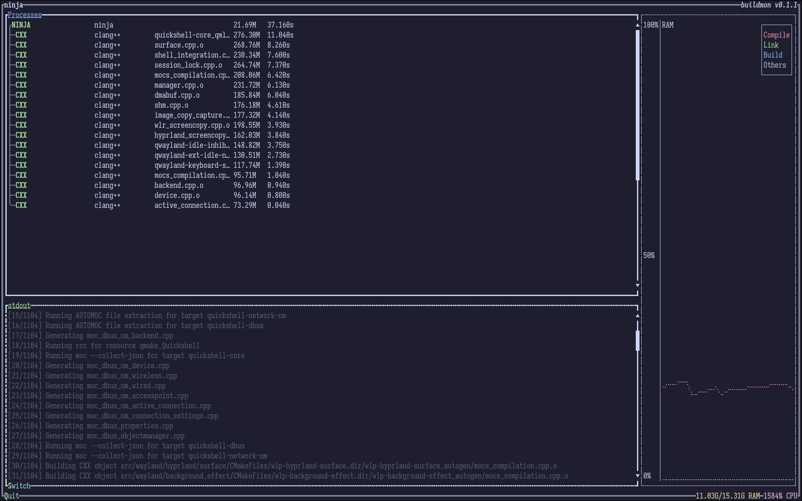

# `buildmon` - Build monitor
Modern C/C++ build systems are capable of running multiple
processes concurrently. Unfortunately, they are rather
bad at reporting which processes are running at any given moment
and how many system resources do they consume.

`buildmon` is designed to bridge this gap: it displays, in
a concise TUI, 
a tree of processes launched by the build system, along with
uptime and memory consumption of each process.



## Features
* Recognizes common instrument types: compiler, linker,
  assembler, etc.
* Recognizes artifact names
* Parses GNU C/C++, Zig & Rust options
* Intercepts stdout and stderr of the build process
* Plots RAM usage in real time
* Displays uptime and memory consumption of each process
* Can be useful with any build system that orchestrates processes

## Installation
### Requirements
Only Linux is supported (tested on 7.2, may work on 5.0+).
`procfs` must be mounted at `/proc`.

You will need at least a 123x12 terminal to use the program.

### Install with cargo
`buildmon` can be installed directly from GitHub using cargo:
```
cargo install --git https://github.com/nikitamos/buildmon
```
The build is known to work on Rust 1.98.1+.

## Usage
To run a program under monitor, just prepend `buildmon`
before your normal build command. All further arguments will
be passed to the build process.

For example, if you are building with `cmake --build .`
command, run
```
buildmon cmake --build .
```

## License
MIT